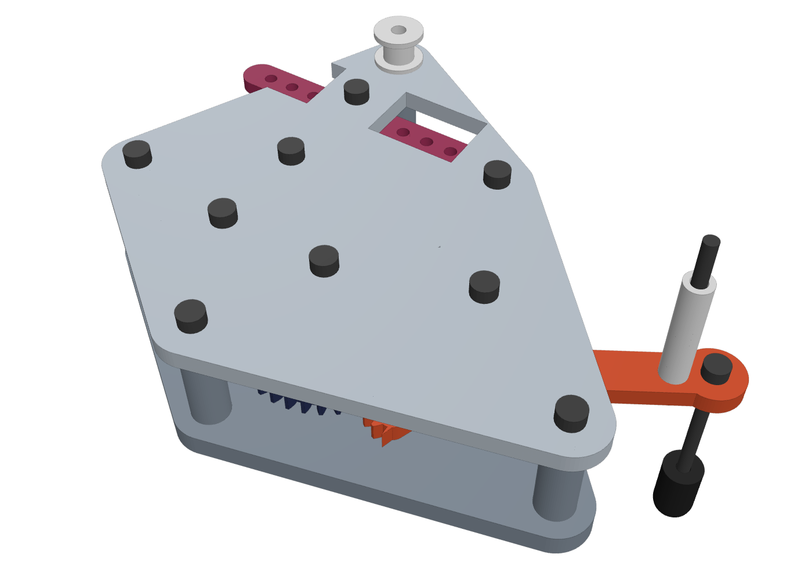
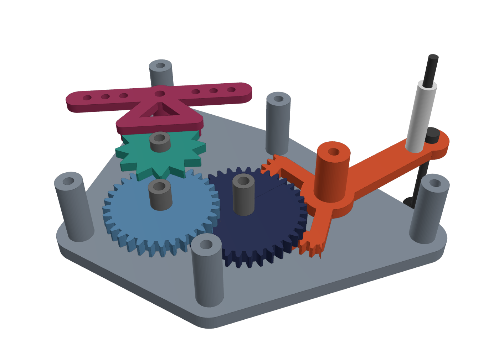
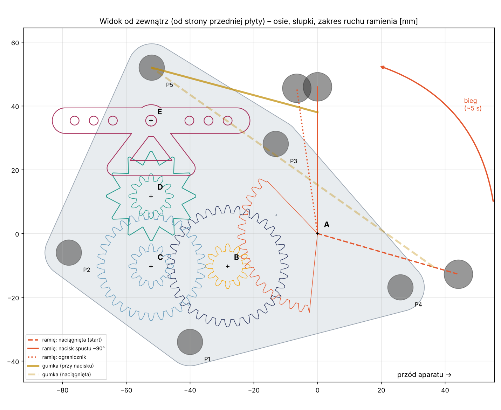
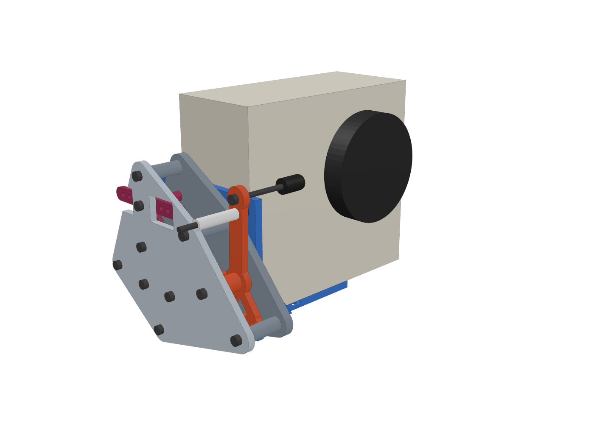

# Mechaniczny samowyzwalacz ~5 s do Instax Square (druk 3D + śruby M3)

Działa bez prądu i elektroniki. Naciągasz palcem ramię i puszczasz. Gumka obraca ramię,
a przekładnia z wychwytem (tik‑tik jak w minutniku kuchennym) spowalnia ruch do około 5 s.
Na końcu cyklu „palec” na ramieniu dociska spust aparatu.




## Jak to działa

```
gumka ──► ramię + sektor Z48 ──► zębnik Z12 ═(sprzęgło zapadkowe)═ koło Z36 ──► zębnik Z12 + koło Z32
                                                                  ──► zębnik Z12 + koło wychwytowe (12 zębów)
                                                                  ──► wahacz z 2 kołkami + obciążniki M3
```

* **Przełożenie** 48/12 · 36/12 · 32/12 = **32**. Ramię obraca się o ok. 106°, więc koło wychwytowe robi ok. 9,4 obrotu.
* **Wychwyt** ma koło z trójkątnymi zębami i wahacz z dwoma kołkami (verge z odbiciem, jak w minutnikach i starych samowyzwalaczach).
  Bezwładność wahacza ustala tempo. Regulujesz je śrubami M3 z nakrętkami wkręcanymi w otwory na końcach wahacza.
* **Sprzęgło zapadkowe** siedzi w kole B. Przy naciąganiu ramienia zapadki przeskakują (słychać grzechotkę), więc wychwyt się nie cofa.
  Przy biegu zapadki zabierają koło.
* **Ograniczniki**: słupki P3 i P4 zatrzymują ramię w obu skrajnych położeniach. Zakres ruchu wynosi −16°…98°.
* Wszystkie osie to **śruby M3**: wkręcane od przodu przez przednią płytę, przez część obrotową, w tylną płytę.
  Tylna płyta jest od spodu gładka (śruby nie wychodzą), więc przykręca się ją płasko do uchwytu.



## Sprawdzone komputerowo

* Brak kolizji między częściami w całym zakresie ruchu dźwigni (`src/check.py`).
* Zazębienia wszystkich par toczą się bez interferencji, z luzem 0,2 mm (`src/meshcheck.py`).
* Prześwit między śrubą palca a płytami ≥ 5 mm, między łbem śruby gumki a płytami ≥ 1 mm.
* Symulacja dynamiki wychwytu 2D (`src/escsim.py`, `src/timetable.py`). Wychwyt rusza z każdej pozycji startowej
  i nie blokuje się przy tarciu µ = 0,2…0,45. Szacowany czas pełnego cyklu:

| moment na kole wychwytowym | bez obciążników | 2× M3×8 @24 mm | 2× M3×8 + 2 nakrętki @24 | 2× M3×8 + 6 nakrętek @24 |
|---|---|---|---|---|
| 2 mN·m (słabsza gumka) | ~4,5 s | ~4,8 s | ~6,9 s | ~8,6 s |
| 4 mN·m (mocniejsza gumka) | ~3,1 s | ~3,4 s | ~4,9 s | ~6,5 s |

Tarcie w prawdziwych drukowanych kołach będzie inne niż w modelu, więc **czas trzeba dostroić obciążnikami** (patrz niżej).

## Lista części do druku (`stl/`)

Pliki są już obrócone do druku i nie wymagają podpór.

| plik | szt. | uwagi |
|---|---|---|
| 01_plyta_tylna | 1 | ze słupkami |
| 02_plyta_przednia | 1 | z okienkami na obciążniki wahacza |
| 03_dzwignia | 1 | ramię + sektor zębaty |
| 04_zebnik_B_zapadki | 1 | **najlepiej PETG** (sprężyste zapadki) |
| 05_kolo_B36_zapadkowe | 1 | |
| 06_kolo_C | 1 | |
| 07_kolo_wychwytowe_D | 1 | |
| 08_wahacz_E | 1 | |
| 09/10/11_tuleja_B/C/D | po 1 | tuleje dystansowe na osiach |
| 12_nakladka_palca | 1 | może być z TPU (miększy nacisk) |
| 13_tuleja_gumki | 1 | |
| 14_szpulka_gumki | 1 | |
| 15_uchwyt_instax | 1 | wspornik L pod aparat |

**Ustawienia (Bambu Lab X2D, dysza 0,4):** PLA lub PETG, warstwa 0,12 mm dla kół (01–08), 0,2 mm dla reszty.
4 obrysy, wypełnienie 25–40%, bez podpór. W Bambu Studio włącz *Arachne*, bo zęby m = 1 wyjdą ładniej.
Jeśli koła chodzą ciasno, zmniejsz kompensację XY o −0,05 mm albo zwiększ `backlash` w `src/gen.py`.

## Elementy złączne

| element | szt. | gdzie |
|---|---|---|
| M3×30 | 9 | osie A, B, C, D, E + słupki P1–P4 (łeb na przedniej płycie) |
| M3×35 | 1 | słupek P5 przez szpulkę gumki |
| M3×40 + nakrętka | 1 | śruba gumki na ramieniu (r = 38 mm, łeb od spodu ramienia) |
| M3×50 + nakrętka | 1 | „palec” (r = 46 mm, łeb na górze ramienia, nakrętka kontrująca pod ramieniem) |
| M3×8 + nakrętki M3 | 2–6 | obciążniki wahacza (otwory 12 / 18 / 24 mm od osi) |
| M3×8 + podkładki | 2 | moduł → uchwyt |
| gumka recepturka ~40–50 mm (na płasko) | 1–2 | między tuleją na ramieniu a szpulką P5 |
| pasek na rzep 20 mm | 1 | mocowanie uchwytu do aparatu |
| *opcjonalnie* śruba 1/4"-20 + nakrętka 1/4" | 1+1 | tylko jeśli Twój model ma gwint statywowy |

Otwory 2,8 mm są pod wkręcenie M3 bezpośrednio w plastik. Otwory 3,4 mm są obrotowe (części obracają się na śrubie).

## Montaż

1. Tylna płyta leży słupkami do góry. Nałóż kolejno na osie:
   * **A**: dźwignia (ramię na dole),
   * **B**: zębnik z zapadkami (zębnik na dole), na niego koło B36 (kieszenią z zębami zapadkowymi w dół, na zapadki), potem tuleja B,
   * **C**: koło C (zębnik Z12 na dole, koło Z32 na górze), tuleja C,
   * **D**: koło wychwytowe (gwiazdka na górze), tuleja D,
   * **E**: wahacz (kołki w dół, między zęby gwiazdki).
2. Załóż przednią płytę i wkręć śruby osi i słupków. Dokręć tylko tyle, żeby wszystko chodziło lekko,
   bo osiowo jest ok. 0,6 mm luzu.
3. Przekręć ramię ręcznie. W stronę „naciągania” powinno grzechotać sprzęgło. Po puszczeniu ramię wraca, a wahacz tyka.
4. Wkręć w ramię śrubę gumki M3×40 od spodu. Załóż na nią tuleję gumki i nakrętkę. Szpulkę przykręć śrubą M3×35 na P5.
   Gumkę załóż między tuleję a szpulkę (pracuje nad przednią płytą, nad łbami śrub).
5. Wkręć „palec” M3×50 od góry ramienia, skontruj nakrętką od spodu i nakręć na koniec nakładkę.
6. Przykręć moduł do uchwytu: dwie śruby M3 przez pionowe szczeliny w otwory na tylnej płycie (para skrajna albo środkowa,
   co daje przesunięcie przód/tył o 12 mm). Uchwyt przypnij do aparatu paskiem na rzep przez szczeliny w podstawie.



## Ustawienie na aparacie

* Moduł montujesz na **prawym boku aparatu** (patrząc od tyłu). Ramię w pozycji końcowej stoi pionowo,
  a nakładka „palca” leży na spuście. **Palec nie może przechodzić przed obiektywem.**
* Wysokość ustawiasz szczelinami w uchwycie, głębokość (w stronę środka aparatu) wkręcając palec w ramię.
* Moduł musi dojechać do spustu **przed** ogranicznikiem (ok. 90° zamiast 98°). Wtedy dociska go całą siłą gumki.
* Jeśli spust jest po lewej stronie, użyj w slicerze **lustrzanego odbicia wszystkich części** (cały mechanizm też działa w lustrze).

## Strojenie czasu

* **Za szybko** (< 5 s): dodaj obciążniki, czyli śruby M3×8 z nakrętkami symetrycznie po obu stronach wahacza, dalej od osi.
  Możesz też dać słabszą gumkę.
* **Za wolno albo staje**: zdejmij obciążniki, daj mocniejszą lub podwójną gumkę, sprawdź luzy kół (przetrzyj zęby, poluzuj śruby osi).
* **Krótszy czas „na chwilę”**: naciągnij ramię mniej niż do oporu. Czas jest mniej więcej proporcjonalny do kąta naciągnięcia.
* Obciążniki zawsze dawaj **parami, symetrycznie**, żeby wahacz był wyważony.

## Ograniczenia, które warto znać

* Wymiary aparatu w uchwycie to Instax Square SQ1 (130,7 × 118,6 × 57,5 mm). **SQ1 nie ma gwintu statywowego**,
  dlatego uchwyt trzyma się paskiem. Szczelina 1/4" i gniazdo na nakrętkę statywową przydadzą się w modelach z gwintem.
* Ze względu na wysokość modułu uchwyt w obecnej postaci obsługuje spust położony mniej więcej **≥ 80 mm nad spodem aparatu**.
  Jeśli Twój spust jest niżej, trzeba zmienić `bracket()` w `src/gen.py` (np. podnieść aparat grubszą podstawą).
* Siła nacisku to ok. 1,5–3 N (zależnie od gumki). Spust w SQ1 jest lekki, więc to wystarcza.

## Edycja projektu

Wszystko jest parametryczne w `src/gen.py` (Python + `manifold3d`):

```
pip install manifold3d trimesh numpy
python3 src/gen.py        # generuje STL do stl/
python3 src/check.py      # kontrola kolizji i prześwitów
python3 src/timetable.py  # symulacja czasu cyklu
```

Najważniejsze parametry: `P` (moduł kół, liczby zębów, geometria wychwytu, luzy), `CAM` (wymiary aparatu),
`UP_SLOTS_Y` / `UP_SLOT_Z` (szczeliny uchwytu), `WEIGHT_X` (pozycje obciążników).
